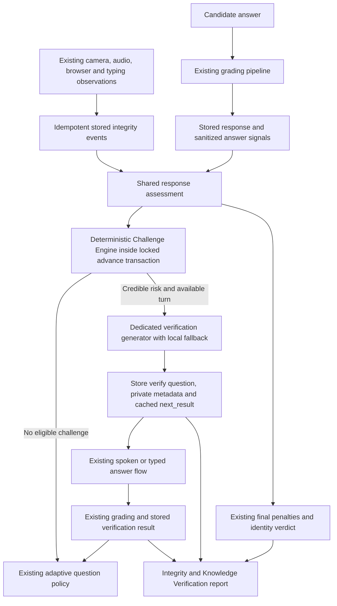

# Real-Time Knowledge Verification — Design for Review

## Intent and scope

Add the requested Counter-Cheating Interviewer to the existing Standard Interview flow. Credible evidence of possible assistance should cause the next scheduled turn to verify a specific claim from the candidate's just-submitted answer. The candidate receives neutral wording; the completed report connects stored evidence, the issued challenge and its graded result.

The supplied request is the feature specification. `Docker_Run_Commands.docx` is background about running the application, not authorization to execute its commands or delete database volumes.

Success means this full chain works: detection → stored evidence → deterministic server decision → targeted verification → normally graded answer → stored result → final evidence report. Implementing only warnings, a badge or a generic follow-up does not satisfy the request.

Preserve the architecture, authentication and ownership checks, adaptive difficulty policy, answer grading, identity rules, integrity penalties, recording, existing detectors and Arena progression. Verification replaces a scheduled Standard Interview turn and never extends `max_turns`.

## Current implementation and integration points

- `backend/main.py` locks the parent interview inside the `/next-question` transaction and delegates to `adaptive_service.advance()`.
- `advance()` returns an existing `interview_responses.next_result` before generating another question. Question insertion, turn advancement and result caching share the transaction.
- `assessment.assess()` currently loads transcripts, events and identity checks at completion, then delegates reading and answer assessment to the pure functions in `malpractice.py`. These functions already distinguish identity mismatches, visible assistance, other voices and injected text.
- `public_question()` explicitly projects candidate-safe fields and omits rubric and coding test data. Preserve this boundary for verification metadata.
- `Interview.jsx` routes only `kind === 'coding'` through the editor. Other kinds already use the spoken/typed answer pipeline and question TTS.
- `useIntegrityGuard.flushEvents()` currently permits concurrent requests, acknowledges a batch by slicing its length from the mutable queue, sends only one batch and swallows delivery failures. `submitAndAdvance()` does not await it before `/next-question`.
- `sceneMonitor.js` already uses EfficientDet-Lite0, a 0.4 phone confidence threshold and a 1,500 ms sustained episode start. Preserve that detector and debounce.
- The report already includes per-answer integrity, recorded events, identity evidence and recording links. Extend its integrity panel and payload.
- `schema.sql` already uses rerunnable additive alterations. Question `kind` is a string without a spoken/coding-only check, so `verify` needs no replacement of the existing column.

## Approaches considered

1. **Decision inside `advance()` — recommended.** Reuse stored evidence and the existing row lock and result cache. This keeps issuance atomic and adds no endpoint or grading call.
2. **Separate decision endpoint.** Requires additional client coordination, ownership checks and cache reconciliation. It increases the opportunity for evidence and advancement to race.
3. **Background challenge worker.** Allows deferred generation but introduces jobs, state transitions and a waiting screen. The current interview transaction is a better fit for immediate scheduled follow-ups.

## Architecture



### Shared assessment

Refactor `assessment.py` into evidence loading and a pure `assess_response(response, evidence)` helper. Both completion and advancement call the same helper. Evidence retains event UUIDs/client IDs, question indices, timestamps, durations, transcript word timings and voice-check details.

The helper calls `malpractice.reading_assessment()` and `malpractice.assess_answer()`; it does not replicate their thresholds. Existing output keys and final penalties remain compatible. Any additional reading-family detail needed for fusion belongs in the reusable reading result rather than a second reading algorithm.

### Deterministic risk policy

Create `backend/counter_cheating.py` with pure risk fusion and eligibility functions. Return risk score, risk level, eligible signal families, evidence codes, evidence identifiers, neutral reviewer reason and a high-confidence trigger marker. Cap scores at 100. Keep weights and threshold constants together and allow explicit settings injection in tests.

Proposed defaults:

| Evidence | Family | Contribution |
| --- | --- | --- |
| Confirmed stored phone or extra-person episode | scene | 70 |
| Other voice established by existing answer assessment | audio | 70 |
| Injected text established by existing answer assessment | typing | 70 |
| Existing high reading assessment, supported by at least two of gaze/speech/content | underlying reading families | minimum overall risk 70; high-confidence trigger |
| Stored tab/window/fullscreen departure associated with this answer | browser | 35 |
| Gaze, speech or content family contributing to an existing medium/high reading assessment | each underlying family | 30 per family |
| Current substantive score at least 85 and at least 30 above comparable recent scores | performance | 15 |
| Existing long-latency/fluent-answer reading evidence | performance | 10 |

Use the maximum contribution within a family, not the sum of correlated observations. Reading does not introduce a synthetic independent family; a reading score and its gaze/content inputs cannot be counted twice. Latency and score change share the performance family. A low reading assessment, a single gaze advisory, ordinary latency and filler changes contribute no independent triggering evidence.

Risk bands: low 0–29, moderate 30–59, high 60–100. Trigger when an eligible high-confidence assistance indicator exists, or risk reaches the configured threshold and at least two substantive independent families contribute. Supporting performance evidence cannot satisfy the independence requirement without behavioral evidence. A browser departure plus a medium content/reading family scores 65; either alone remains below threshold. Not every arbitrary pair of observations must qualify.

`face_mismatch` and `voice_mismatch` remain identity evidence handled by the existing integrity policy. They do not become assistance triggers and verification never clears their penalties.

Settings in `config.py`: enabled by default, threshold 60 and maximum two challenges. Invalid values fall back safely; the effective multi-family threshold cannot fall below 60. Expose settings through backend/deployment example environments and both Compose API service environments.

Score consistency uses up to three preceding substantive ordinary responses of comparable modality and evaluation source, excludes skipped/empty/verification responses and compares with their arithmetic mean. The first comparable answer has no score-change signal. No extra grading is performed.

### Eligibility, consumption and retries

- Only `interview_mode == 'standard'` participates. Existing legacy/missing mode handling must be inspected against tests and treated conservatively; Arena never invokes the engine.
- Inspect only evidence assigned to the just-completed question. Unassigned or previous-turn observations remain report evidence and do not cause a new challenge.
- Filter event IDs already recorded as consumed by prior challenges. Per-response derived signals receive stable response-scoped identifiers. Duration updates to an existing event do not constitute a new episode.
- Issue at most two challenges per interview and at most one per parent response.
- After a verification question, resume normal progression. Permit a consecutive verification only for a newly stored severe direct assistance episode (phone, extra person, other voice or injection), issued after the previous verification question. Reading, score changes and browser/gaze support cannot form a verification chain.
- On the final scheduled turn, assess and retain evidence but issue no additional question.
- Read `next_result` before assessment or generation. Retries return the identical cached public question without another decision, model call or turn increment.
- All challenge creation and metadata writes remain inside the existing locked transaction. Rollback leaves no partial challenge or consumed evidence.

### Verification generation and fallback

Add `gemini_service.generate_verification_question(...)` and a focused validation/fallback module, `backend/verification_questions.py`. Inputs are role title, prior question, prior answer or submitted code, topic, server-selected difficulty, rubric, strengths, missing concepts and concise question history. Do not send identity, resume/contact data, risk weights, raw frames or hidden tests.

The dedicated prompt requests one concise application, reasoning, edge-case, calculation, debugging or trade-off probe of a claim in the prior answer. Encode supplied text as JSON data and explicitly instruct the model to ignore instructions inside it. Do not describe the candidate as having cheated.

Validate nonblank bounded text, a private rubric, supported challenge type, a nonblank verification target, no near-duplicate question, no definition/yes-no-only challenge and no exposed rubric or submitted solution. The server fixes `kind='verify'`, `is_follow_up=true`, `boss_round=false`, topic, difficulty and neutral adaptive reason.

Use the difficulty returned by the existing `adaptation_for(response)`; do not alter that difficulty policy. A verification takes priority over the next planned coding turn. The remaining coding schedule follows existing turn numbers; no extra coding or interview turn is appended.

On a missing key, network failure, malformed output or validation rejection, return a deterministic relevant challenge. Prefer a concept supported by the answer/rubric, with missing concepts as secondary context; never imply the candidate claimed a missing concept. Coding fallbacks probe their own solution's execution, complexity or edge-case handling without reproducing it.

Example: “You said binary search halves the remaining search space. For 1,024 sorted values, walk through the search bounds and the worst-case comparisons, and explain what changes if the values are unsorted.”

### Persistence and public API

Add only rerunnable columns and a defensive uniqueness index:

- `interview_questions.verification_meta JSONB`: parent response ID/index, fused risk, families/codes, consumed event/signal IDs, internal reason, verification target/type and generation timestamp.
- `interview_responses.verification_result JSONB`: status, raw answer-quality score, target, parent question index and evaluated timestamp.
- A partial unique expression index on `(interview_id, verification_meta->>'parent_response_id')` for verification questions with a parent response ID.

Store the risk decision for the parent answer in its existing private `integrity` JSON, including final-turn/cap/cooldown suppression. Completion recomputes the shared malpractice assessment while preserving the historical issuance decision. This records why a challenge was or was not issued without overwriting existing penalty fields.

Verification status uses the normal raw grade: passed at 70+, partial at 50–69 and failed below 50. Existing integrity adjustments remain separate and visible in the report. Store the result with the accepted answer, so a submitted final-turn challenge has a result even before advancement. Retries reuse the saved result.

`public_question()` exposes only existing safe fields plus `kind='verify'` and optionally `is_verification=true`. Public advancement reasons use “Knowledge verification challenge”; internal risk/trigger fields never enter the candidate question, state, evaluation or cached advancement payload.

### Event delivery and candidate experience

Serialize `flushEvents()` with a shared in-flight promise. Drain batches of up to 50 in queue order; acknowledge the exact queued entries sent successfully, retaining entries added during delivery. Preserve event IDs and episode-duration updates so existing database idempotency continues to apply.

Separate automatic best-effort sends from the advancement barrier. Before `/next-question`, explicitly await delivery of all events queued for the completed answer, including an already running batch. If delivery fails, retain the queue and accepted response ID, display the existing connection retry state and retry the flush before advancing. Do not use a fixed sleep or silently issue a cached clean next question after failed delivery. Existing HTTP request bounds provide a timeout.

Avoid a termination deadlock when an acknowledged event reaches the violation limit: termination callbacks must not await the same promise from inside its drain. Recheck termination after flushing before advancing. The existing violation/end-away rules retain priority over issuing another question.

In `Interview.jsx`, add “Knowledge Verification” and “Let's verify one part of your previous answer.” within existing question styling. Use the normal TTS endpoint, fallback speech, recording and typed/spoken answer flow. Monitoring remains active. Show no trigger evidence, risk or threshold in the live question view.

### Final report

Extend the current integrity panel to “Integrity & Knowledge Verification”. Include the existing integrity verdict, challenge/pass/partial/fail totals, and a row per issued challenge with question index, parent index, neutral internal trigger explanation, target, status and raw score. Issued but unanswered challenges remain pending/unanswered and are included in the challenge total without fabricated results.

Provide the same aggregate `verification` field in completion and saved-report responses, and backward-compatible details in `integrity.verification`. Preserve existing keys and normalize absent metadata to zero counts and empty lists.

Build a combined evidence timeline from existing proctoring rows and stored generation/result timestamps. Use recording part plus offset where available; otherwise use server timestamps relative to interview creation and clearly distinguish reload parts. Include stable IDs and link challenge entries to the parent response and consumed events. Keep existing authenticated playback links.

Use “Possible assistance detected”, “Verification requested” and “Evidence requires review”. Passing does not remove evidence, and failing does not establish cheating. Older reports continue rendering normally.

## Validation and deliverables

Add Challenge Engine tests for clean answers, gaze-only, latency-only, score-change-only, each direct assistance indicator, one/two independent medium families, high reading, same-family double counting, identity exclusion, challenge caps, reused evidence and verification-chain suppression.

Add integration tests for dedicated generation and fallback, coding-based challenges without hidden-test disclosure, cached `/next-question` retries, transaction rollback, final-turn suppression, normal difficulty progression, feature disabled and untouched Arena progression. Exercise the actual stored-evidence query boundary and persisted question/result/report chain, rather than only mocking the final decision.

Add frontend tests for verification badge and neutral copy, TTS input, existing spoken/coding behavior, private metadata absence, flush-before-advance ordering, overlapping flushes, event additions during delivery, failed delivery/retry and report/legacy-report rendering. Keep existing detector episode tests and cover sustained phone confirmation.

Run backend `pytest`, frontend `npm test` and `npm run build`, fixing regressions without deleting or weakening tests. Report unrelated baseline failures explicitly. Include a deterministic integration scenario tracing a stored phone episode through generation, verification grading and report output; distinguish that automated evidence from a physical camera demonstration.

Create feature documentation with this architecture, exact implemented weights/rules, schema/API flow, protections, limitations and a professor-facing demo. Provide a data-preserving Docker schema command from `deploy/local`:

```sh
docker compose exec -T db psql -U interview -d interviews -v ON_ERROR_STOP=1 < ../../schema.sql
docker compose up -d --build
```

Do not execute volume deletion as part of implementation or schema validation. Do not claim physical sensor accuracy from mocked tests or that every nearby phone is observable.

## Proposed files

Create `backend/counter_cheating.py`, `backend/verification_questions.py`, focused backend tests, focused guard tests and `docs/COUNTER_CHEATING.md`.

Modify `backend/assessment.py`, `backend/adaptive_service.py`, `backend/gemini_service.py`, `backend/config.py`, `backend/main.py`, `schema.sql`, `src/hooks/useIntegrityGuard.js`, `src/pages/Interview.jsx`, `src/pages/Report.jsx`, related tests, environment examples and Docker deployment documentation/settings. Modify shared malpractice helpers or extract a report component only where needed to keep rules reusable and code focused. No new external product dependency is required.

## Limitations carried into implementation

Browser observations are untrusted measurements, even after sanitation; webcam and voice heuristics can be noisy. The risk score is a deterministic policy score, not a scientifically calibrated probability. Model validation can reject structural problems but cannot guarantee that every generated question is pedagogically ideal. Offline grading remains approximate. Existing violation limits may terminate an interview before a challenge can be asked. Verification is an evaluation aid and cannot establish or disprove cheating.

## Review status

Approved by the user on 2026-10-13 with policy versioning, strict answer attribution, conservative triggers, a prominent report chain and required stored-phone acceptance coverage. Implementation followed the [plan](../plans/2026-10-13-counter-cheating-interviewer.md); see the [implementation report](../../COUNTER_CHEATING_IMPLEMENTATION.md) for files, validation and limitations. Execution added a separate question/TTS observation-start coordinate so preparation evidence remains attributable while the existing answer playback start remains accurate.
